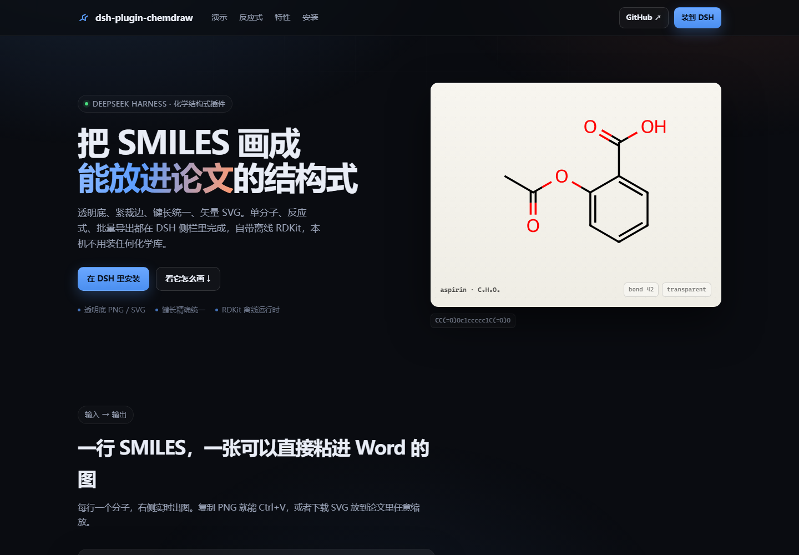

# dsh-plugin-chemdraw

把 SMILES 渲染成**键线式**结构图，专为放进 Word 文档、画反应式和批量出图设计。

- **透明底**：没有白块、没有边框，压在 Word 白页上自然融合
- **紧裁边**：按墨迹范围裁切，四周只有几个像素
- **键长统一**：`bond` 相同的结构在任何尺寸下键长都精确一致，一张图里多个分子自动对齐
- **矢量输出**：SVG 任意缩放不糊（Word 2016+ 直接插入），需要位图时给 PNG
- **立体化学画对**：手性 H 的位置经过几何重算，稠环/桥环上不再压住相邻键线

适用 DSH 桌面版；自带 RDKit 运行时，本机不需要装 Python 或化学库。

**在线演示**：<https://Hilyce.github.io/dsh-plugin-chemdraw/demo/> —— 结构式描边动画、面板打字机、反应式排版都能直接看。`demo/index.html` 是**单文件**（约 186 KB，图片全部内联），可以直接发给别人；改完跑 `node demo/build.mjs` 重新生成。



## 安装

**方式一（界面，推荐）**：侧栏「插件」→ **添加插件** → 输入包名 `dsh-plugin-chemdraw` → 安装 → 立即启用。

**方式二（命令行）**：

```bash
dsh plugin --profile desktop add dsh-plugin-chemdraw
```

**方式三（本地目录，开发时用）**：

```bash
dsh plugin --profile desktop add "D:\path\to\dsh-plugin-chemdraw"
```

装完**重启 DeepSeek Harness**（完全退出再打开），Host 才会加载新的插件代码。
面板只需刷新页面（F5）。

### 在 Discover 里搜到

DSH 的 **Discover** 标签读的不是 npm 搜索，而是**插件市场索引**（一份 format 1 的 JSON）。
本仓库自带一份索引：`market/index.json`。把它发布到 GitHub Pages 后，在
「插件 → Discover → 添加索引源」里填：

```
https://Hilyce.github.io/dsh-plugin-chemdraw/market/index.json
```

之后就能在 Discover 里搜 `chemdraw` / `smiles` / `结构式` 并直接安装。
索引随 `npm run market:index` 重新生成，详见 [PUBLISH.md](PUBLISH.md)。

## 三个入口

### 1. 右侧栏面板

侧栏「+」→ **结构式**，四种模式：

| 模式 | 输入 | 用途 |
|---|---|---|
| **单分子** | 每行一个 SMILES | 逐张预览；**复制 PNG** 后直接在 Word 里 Ctrl+V，或下载 PNG/SVG |
| **反应式** | `底物.底物>>产物.产物`，可填箭头条件 | 自动排版箭头与「+」，各组分同尺度 |
| **批量** | 每行一个 SMILES + 输出目录 | 导出成文件夹，附带 `index.html` 预览页 |
| **手绘** | 鼠标/触屏直接画 | 没有 SMILES 也能画：点碳、拖碳链、拖苯环和 N/O 上去 |

PNG 是 4 倍超采样后从矢量重绘的，粘进 Word 或放大看都不糊。

#### 手绘模式怎么用

- **放一个碳**：点工具条「碳」→ 点画板空白处（孤立碳显示 `CH₄`）；
- **画碳链**：按住已有原子往空白处拖，一次拖动就会沿 30° 网格长出一串锯齿碳链；拖回已有原子则闭环；
- **换元素**：左边模板点 `N` / `O` / `S` / `P` / `F` / `Cl` / `Br` / `I` / `OH` / `NH₂` / `CH₃`，再点已有原子；
- **苯环**：模板里的「苯环」拖到画板（或点一下再点画板），自动补交替双键；
- **键级**：单 / 双 / 三键作用于新画的键；环里的双键自动画在内侧；
- **擦除 / 撤销 / 重做 / 清空**：底部有按钮，画板右上角还有一个悬浮「清空」，一键清空并收起识别卡（可撤销）；
- **导出**：复制 PNG / 下载 PNG / 下载 SVG，透明底、按内容紧裁，和 SMILES 渲染出来的图同样能直接进 Word。

手绘的结果保存在面板里，切到别的模式再切回来不会丢。

#### 画完自动命名（IUPAC + 常用名）

画板下方会自动出现一张识别卡，改一笔就更新一次：

| 字段 | 来源 |
|---|---|
| **IUPAC 系统名** | [openclatura](https://github.com/lamalab-org/openclatura)，离线、按 IUPAC 蓝皮书规则确定性生成，不联网、不是模型猜的 |
| **常用名** | 内置 93 个常见化合物（中英对照，如「甲烷 · methane」「对甲酚 · p-cresol」），按 InChIKey 精确匹配，退化时按骨架匹配并标注 |
| **分子式 / 分子量** | RDKit 计算 |
| **规范 SMILES** | 一键复制，可接着回「单分子」模式继续用 |

点了「重新渲染」会用 Host 的 RDKit 把结构重画一遍（和「单分子」模式完全同款：键长统一、透明底、紧裁边），
再复制 PNG / 下载 PNG / SVG。手绘时的坐标只决定连接关系，最终出图由 RDKit 重新排版。

结构画错了（比如碳连了 5 根键）不会静默出图，识别卡会直接给出「结构不合法」的原因。

### 2. Agent 工具

```
smiles_to_structure(smiles="CC(=O)Oc1ccccc1C(=O)O", out="D:\\x\\aspirin.svg", bond=42)
smiles_reaction(scheme="CC(=O)O.OCC>>CC(=O)OCC.O", out="D:\\x\\rxn.svg", reagents="H2SO4, cat.")
smiles_batch(smiles="CCO\nc1ccccc1O", outDir="D:\\x\\batch", format="png")
```

`out` / `outDir` 必须是绝对路径（Host 的工作目录是 profile 目录，不适合当默认输出位置）。

### 3. HTTP 路由

```
GET  /chemdraw/render?smiles=CCO&format=svg&bond=42&color=0&annotate=0&white=0
GET  /chemdraw/reaction?scheme=A.B>>C&reagents=H2SO4&format=svg
POST /chemdraw/batch  {items:[{smiles}], outDir:"D:\\x", format:"svg"}
```

`color=1` 彩色杂原子，`annotate=1` 标 R/S，`white=1` 白底不透明（默认透明）。

## 依赖

插件自带 RDKit 运行时（`runtime/`，cp312 wheel，约 57 MB），使用 DSH 桌面版内置的
Python 3.12，不需要你本机装任何东西。

要换解释器或加搜索路径，在 profile 的 `cordis.patch.yml` 里覆盖：

```yaml
- id: chemdraw
  name: dsh-plugin-chemdraw
  config:
    pythonPath: 'C:\Python312\python.exe'    # 默认用内置 runtime
    pyPath: 'D:\somewhere\site-packages'     # 额外 PYTHONPATH（rdkit 所在目录）
    timeoutMs: 25000
```

## 实现

```
index.js     Host 半侧：4 个 HTTP 路由 + 3 个 agent 工具 + Python worker 管理
client.js    浏览器半侧：右侧栏 tab（四种模式，含手绘画板），只用 --dsw-alias-* 主题变量
worker.py    常驻渲染进程，一行请求一行响应，避免每条请求重新 import RDKit
render.py    单分子渲染：布局、手性 H 修正、透明底、紧裁、固定键长
scheme.py    反应式拼装（SVG 用 <g transform> 拼、PNG 用 PIL 拼）与批量导出
identify.py  结构识别：molblock/SMILES → 规范 SMILES、分子式、分子量、InChI、IUPAC 名、常用名
data/        常用名表（86 个化合物，InChIKey 索引）与生成脚本
runtime/     RDKit（cp312）+ openclatura（离线 IUPAC 命名）
scripts/     发布辅助：生成市场索引、替换仓库占位符
market/      插件市场索引（Discover 用）
```

### 两个值得记下的坑

**1. RDKit 的 `fixedBondLength` 会静默回缩。**
当「画布 /（键长 × 字号）」过小时，RDKit 为了塞下原子标签会把整张画缩放，
键长就不准了（实测键长 120 px 的画在 2000 px 画布上只剩 14 px）。
现在画布按 `2.8 × 键长 × 字号` 兜底，绘制后用 `GetDrawCoords` 实测键长校验，
不一致就放大画布重画。这是「多分子同尺度」能成立的前提。

**2. 手性 H 默认会压键线。**
`PrepareMolForDrawing` 补出来的手性 H 只按「背离邻居质心」定位，在稠环/桥环的
环并处那个方向正好插进环内。现在对每个手性 H 采样 72 个方向，按「到其它原子、
到其它键段」的最小距离打分取最空旷处；楔形属性不动，立体化学读法不变。

## 发布

推 GitHub、发 npm、更新市场索引的完整步骤见 [PUBLISH.md](PUBLISH.md)。

## 许可

MIT。`runtime/` 内是未修改的 RDKit wheel（BSD 3-Clause，见 `runtime/rdkit/license.txt`）。


